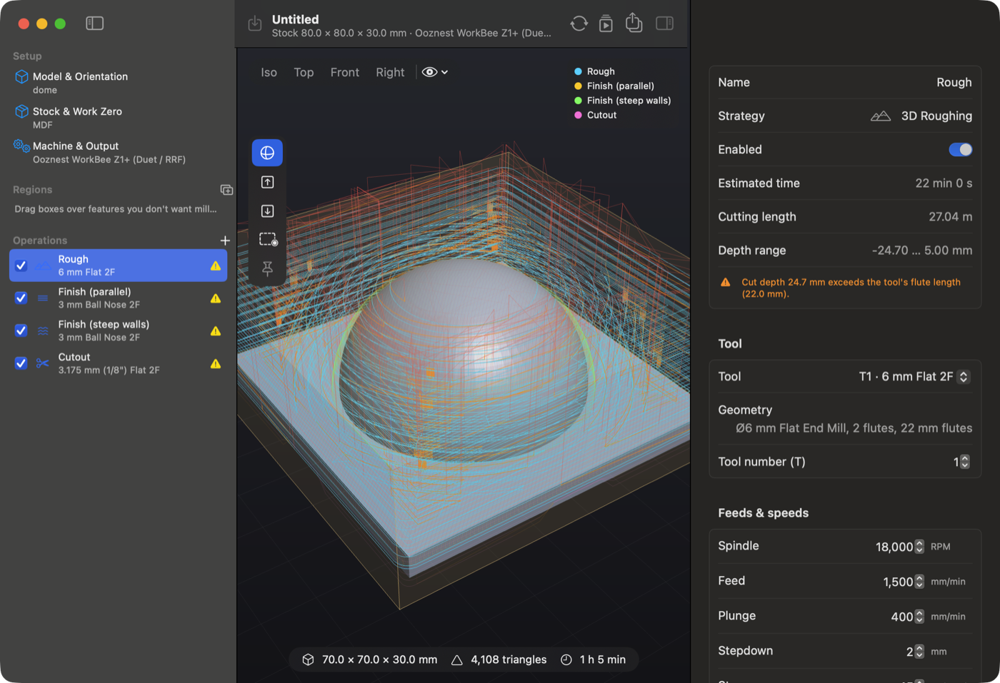
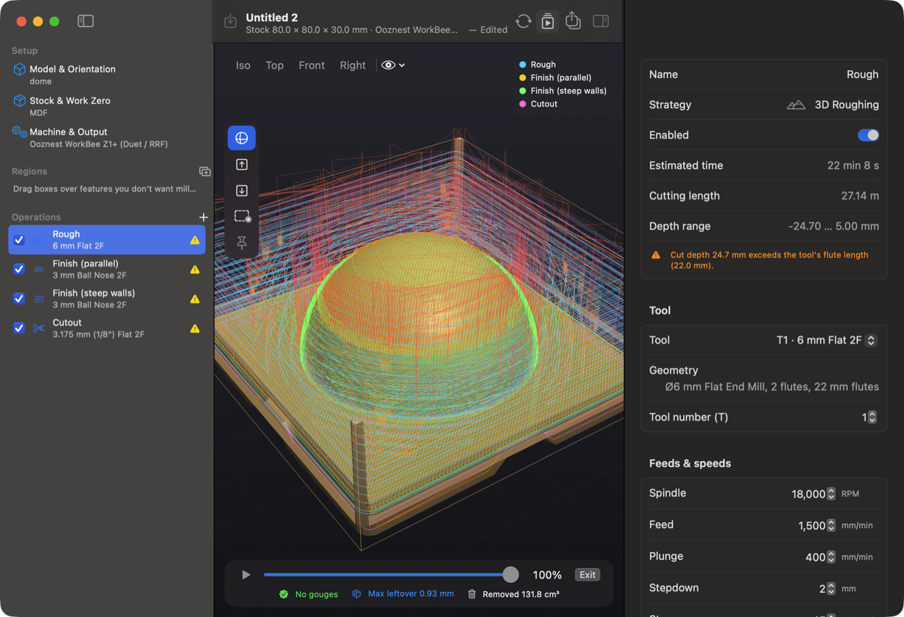
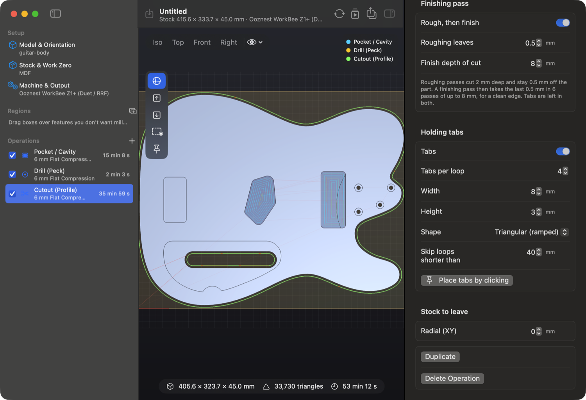
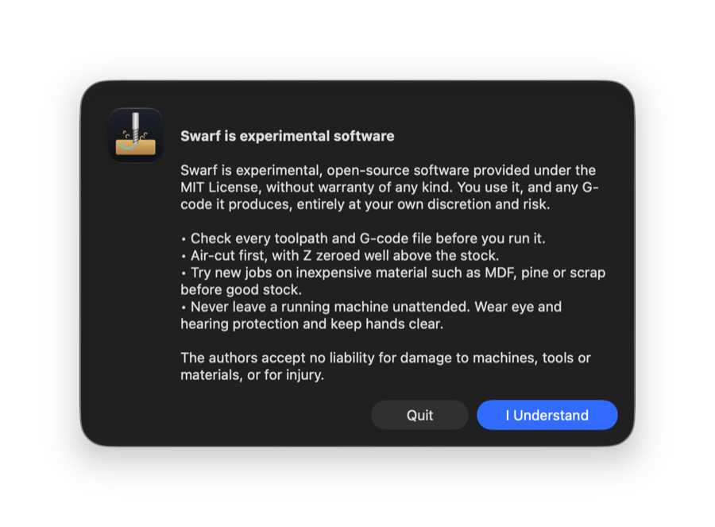

# Swarf

**Free, open-source, Mac-native CAM for hobby CNC.** Swarf turns an STL into G-code. It writes
G-code for GRBL machines (including grblHAL and FluidNC), Duet / RepRapFirmware, Mach3 / 4, LinuxCNC and
more, with a post-processor for each popular hobby machine.



> [!WARNING]
> **Swarf is experimental software. You use it at your own discretion and risk.** Check every
> toolpath before you run it, air-cut new jobs with Z zeroed above the stock, and try new jobs on
> inexpensive material such as MDF or scrap first. Swarf is provided under the MIT License
> **without warranty of any kind**. The app asks you to acknowledge this every time it starts.

📘 **[User guide (PDF)](docs/Swarf-User-Guide.pdf)**: step-by-step instructions from importing an STL to running the job.

## Contents

- [What it does](#what-it-does)
- [Screenshots](#screenshots)
- [Getting started](#getting-started)
- [A typical job](#a-typical-job)
- [Operations](#operations)
- [Tool library](#tool-library)
- [Machines](#machines)
- [Command line](#command-line)
- [How it works](#how-it-works)
- [Safety](#safety)
- [Contributing](#contributing)
- [License](#license)

## What it does

- **Import and orient** a model: rotate in 90° steps, click the face that should point up or lie on
  the bed, or let Swarf lay the largest flat face down. Faces a 3-axis machine can't reach are
  highlighted.
- **Set up the stock and work zero.** The default is the centre of the left edge, top of
  stock.
- **Build the toolpaths.** One click on *Full Processing* analyses the model and adds the operations
  it needs, or you can add them one at a time: facing, pockets, 3D roughing and finishing, V-carving,
  peck drilling and cutouts with holding tabs.
- **Machine both sides** of a part, such as a guitar body with a carved top and control cavities in the
  back. Swarf drills dowel holes through the stock into the spoilboard, machines and cuts out side A,
  then machines side B after you roll the stock over onto dowels. Each step is exported as its own file.
- **Rest machining**: follow a big bit with a small one that cuts only what the big one couldn't reach (square
  inside corners, narrow slots, tight curves), in a few minutes instead of re-cutting the whole pocket.
- **Protect features** with keep-out boxes you drag over the model. Click a box to select it, then
  drag it, nudge it with the arrow keys, or delete it with ⌫.
- **Simulate** material removal, with a gouge check, a leftover-stock heat map, keep-out checks and a
  run-time estimate.
- **Export** G-code for your machine, plus a printable PDF setup sheet.

## Screenshots

| | |
|---|---|
|  |  |
| **Simulation** after pocketing, peck drilling and cutting out a guitar body: no gouges and no leftover material. | **Cutout** with roughing passes that stay 0.5 mm off the part, a finishing pass at 4× the roughing depth, and ramped holding tabs. |



## Getting started

Swarf runs on **macOS 15 or later** and builds from source with Xcode 16 or later (Swift 6).

```bash
git clone https://github.com/mouldiwarp/swarf.git
cd swarf
scripts/build-app.sh          # builds build/Swarf.app
open build/Swarf.app
```

You can copy `build/Swarf.app` to `/Applications`. To run the engine tests:

```bash
swift test -c release
```

## A typical job

1. **Import STL** (⇧⌘I), or drop the file on the window.
2. **Model & Orientation**: make sure the face you want to machine points up.
3. **Stock & Work Zero**: check the stock size, the material and where you'll zero the machine.
4. **Machine & Output**: choose your machine or controller. Any GRBL machine can start from the generic GRBL profile.
5. **Operations**: click **Full Processing**, or **+** to add operations yourself. Select an
   operation to edit its tool, feeds and settings in the inspector on the right.
6. **Simulate** (⌘R): check for red gouges, blue leftover stock and keep-out warnings.
7. **Export G-code** (⌘E). Machines without a tool changer get one file per tool. Zero XY on the corner shown,
   and probe Z before each file.
8. **Air-cut** above the stock, then cut in scrap before cutting good material.

**Test cuts.** Turn on **Test cut mode** in Stock & Work Zero to try a job on scrap such as 9 mm MDF.
Cutouts stop 8 mm below the stock top (the thin skin left holds the part), pockets, carving and V-carving
stop at 4 mm, and drilled holes at 4 mm. The depths can be changed. Exported files are named `_TEST` and
say so in their header. Zero Z on the top of the test board.

The [user guide](docs/Swarf-User-Guide.pdf) covers each step in detail.

## Operations

| Operation | What it does |
|---|---|
| Facing | Surfaces the stock top |
| Pocket / Cavity | 2.5D clearing inside the model outline, with exact passes on every flat floor |
| 3D Roughing | Waterline offset clearing with ramped entries and stock to leave |
| 3D Finish – Parallel | Raster passes at any angle, optionally only on shallow slopes |
| 3D Finish – Waterline | Constant-Z contours, optionally only on steep walls |
| V-Carve | Engraves text and logos with a V-bit. Corners stay sharp and the depth follows the stroke width. Optional flat-bottom depth limit |
| Drill (Peck) | Finds round holes that match the tool diameter and pecks them, with a full retract to clear chips or a short chip-break lift. Blind holes stop at their floor; through holes go below the stock. Output is plain G0/G1, so it runs on any firmware |
| Cutout (Profile) | Cuts the part free, internal holes first, with **holding tabs**. Roughing passes stay 0.5 mm off the part, then a finishing pass takes off the last skin at a deeper cut (4× the roughing stepdown by default) for a clean edge. An optional **wide trench** roughs each level twice, outer pass first, so the slot is 1.5× the cutter and chips clear |
| Dowel Holes (Flip) | Two-sided jobs: registration holes through the stock and 5 mm into the spoilboard, in pairs mirrored across the stock's centre line. Placed automatically (beyond each end of the part, or either side of a waist) or by clicking, with a green/red preview |

In a two-sided job, pockets, 3D roughing and finishing, and drilling can also be set to machine **side B**
(the back). Side B is never cut out, faced or engraved: the part is cut out from side A, and side B
leaves the stock frame and the tabs alone.

**Rest machining.** Pockets, 3D roughing and both 3D finishes can follow a larger tool and cut only the material it
left. Choose **+ ▸ Rest Clearing**, or turn on *Only cut what a larger tool left* in any of those operations and pick
the larger tool. The rest pass uses its own operation's area, depth and stock to leave, and works one corner or slot at
a time from the top down. Small bits often have a shank wider than the cutter (a 0.9 mm bit on a 1/8" or 4 mm shank):
Swarf keeps that shank off the walls above the flutes, so beside a wall the bit only reaches its flute length below the
top of the wall, and it tells you how much it had to leave. After a simulation, Swarf suggests a rest pass when a
clearing operation leaves material a smaller bit in your library could reach.

Every operation has its own tool, spindle speed, feed, plunge rate, stepdown and stepover. You can
also set climb or conventional cutting, stock to leave, and which keep-out regions apply.

## Tool library

Click **Edit Tool Library…** in an operation's Tool section (or press ⇧⌘T, or open **Swarf ▸ Settings ▸ Tool Library**) to add, edit, duplicate or delete tools. Flat, ball nose,
bull nose, V-bit and drill tools are supported. Each tool stores its diameter, flute length,
stick-out and default cutting data, and Swarf shows the chip load with warnings when values look
risky. The library is saved in `~/Library/Application Support/Swarf/tools.json`. You can import
Fusion 360 tool libraries, and import or export Swarf's own JSON.

The starter library includes 6 mm flat and ball-nose compression cutters, smaller flat and ball
cutters, a bull nose, 60° and 45° V-bits, and 2 mm, 1 mm and 0.9 mm flat bits on 1/8" and 4 mm shanks for rest
machining. **Measure your own bits and correct the library before
your first job.** If you edit a tool, open projects pick up the change, while each operation keeps
its own feeds.

## Machines

| Machine | Notes |
|---|---|
| **Ooznest WorkBee Z1+ (Duet / RRF)** (default) | `;` comments, `G4 S` dwell, arcs, one file per tool |
| Generic Duet / RepRapFirmware | Single file with an `M291` tool-change prompt |
| Generic GRBL 1.1 | |
| FoxAlien XE-Pro Ultra (GRBL, 1.5 kW VFD spindle) | `()` comments, 5 s spin-up, 6000-24000 rpm, one file per tool for the offline controller |
| Carbide 3D Shapeoko / Nomad | `M6` for Carbide Motion and BitSetter |
| Sienci LongMill / AltMill | `M6` handled by gSender |
| Inventables X-Carve | |
| SainSmart Genmitsu | |
| Onefinity (Buildbotics) | |
| grblHAL / FluidNC | |
| MASSO G3 | |
| LinuxCNC | |
| Mach3 / Mach4 | |
| UCCNC | |
| Marlin (MPCNC / LowRider) | |

Arc fitting (G2/G3) keeps files small and motion smooth. Profiles are
best-effort. Check the header, spindle and tool-change commands against your controller before your
first cut.

## Command line

`swarf-cli` runs the same engine without the app, which is handy for batch jobs and debugging.

```bash
swift build -c release
.build/release/swarf-cli model.stl --out ./gcode --simulate --png preview.png
.build/release/swarf-cli MyGuitar.swarf --out ./gcode --simulate   # a saved project, machined as saved
.build/release/swarf-cli --list-machines
```

Given a `.swarf` project, the CLI uses its saved operations, regions, stock and work zero.

Options: `--machine <id>`, `--material <id>`, `--quality draft|normal|fine`, `--lay-flat`,
`--rotate x:90`, `--ops facing,pocket,roughing,parallelFinish,waterlineFinish,vcarve,drill,cutout`,
`--keepout x0,y0,x1,y1`, `--vcarve-source recesses|silhouette`, `--vcarve-depth <mm>`,
`--rest <mm>` (add a rest pass with the flat bit closest to that size after each pocket and 3D roughing),
`--trench <x>` (cutouts rough a slot x × the tool diameter wide so chips clear), `--trench-feed <x>` (its second
pass's feed multiple, default 1.25),
`--test-cut [cutout,pocket,drill]` (depths in mm, default `8,4,4`), `--margin <mm>`,
`--flip [spoilboard mm]` (two-sided job; with `--ops`, prefix side-B operations with `b:`, e.g.
`--ops dowelHoles,pocket,cutout,b:pocket`).

## How it works

The engine (`CAMCore`) is pure Swift and uses no GPL code.

1. The oriented mesh is rasterised into a height field. Triangle edges are stamped too, so thin walls
   and ridges are never missed.
2. For each operation, the height field is offset by the exact cutter shape (flat, ball, bull nose or
   V) on the GPU. That gives the lowest safe tool-tip height everywhere.
3. Keep-outs and boundaries raise the height field *before* that offset, so every strategy keeps the
   right clearance.
4. Offsets come from exact Euclidean distance transforms, and contours from marching squares.
5. The simulator removes material from a stock height field and compares the result with the model.

## Safety

CNC machines can cause serious injury. Check toolpaths in the simulator. Air-cut new jobs with Z
zeroed above the stock. Test on inexpensive material, keep hands clear, never leave the machine
running unattended, and wear eye and hearing protection.

## Contributing

Bug reports and pull requests are welcome. See [CONTRIBUTING.md](CONTRIBUTING.md). Planned work
includes a separate clearing tool for
V-carving, editable post-processors and a G-code panel linked to the 3D view.

## License

[MIT](LICENSE) © Swarf contributors. Provided "as is", without warranty of any kind.
